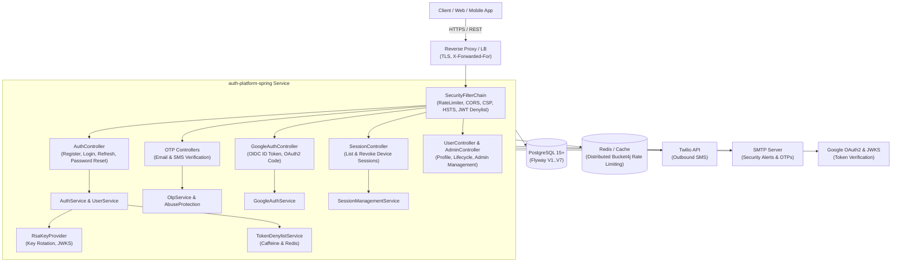

# User Service (`auth-platform-spring`)

[](https://github.com/ayshriv/auth-platform-spring/actions)
[](LICENSE)
[](https://adoptium.net)
[](https://spring.io/projects/spring-boot)

A reusable, production-grade identity and authentication platform by **Ayshriv**. Any developer can clone it, set environment variables, and run it reliably in production.

---

## 1. Architecture Overview



---

## 2. Quick Start

### Prerequisites
- **Java**: Java 21 LTS (`java -version`)
- **Maven**: Maven 3.8+ or use `./mvnw`
- **PostgreSQL**: Running locally or remotely on port 5432
- **Redis** *(Optional for dev, recommended for prod)*: Running on port 6379

### Local Setup
```bash
# 1. Clone repository
git clone https://github.com/ayshriv/auth-platform-spring.git
cd auth-platform-spring

# 2. Setup dev database
psql -U postgres -c "CREATE DATABASE authplatform_dev;"

# 3. Copy sample environment file
cp .env.example .env

# 4. Build and run development server
./mvnw spring-boot:run -Dspring-boot.run.profiles=dev
```
Access the application at `http://localhost:8080`.
Actuator health check: `http://localhost:8080/actuator/health`
Public JWKS endpoint: `http://localhost:8080/.well-known/jwks.json`

---

## 3. API Endpoints Reference

All requests and responses follow a strict envelope format:
- **Success**: `{"status":"success", "data": ..., "metadata": ...}`
- **Error**: `{"status":"error", "errorCode": "E...", "message": ...}`

| Group | Method | Endpoint | Description | Auth Required |
| :--- | :--- | :--- | :--- | :--- |
| **Public** | `GET` | `/api/v1/health` | Service health status probe | None |
| **Public** | `GET` | `/.well-known/jwks.json` | Multi-key RSA public JWKS keys | None |
| **Auth** | `POST` | `/api/v1/auth/register` | Register new user with password | None |
| **Auth** | `POST` | `/api/v1/auth/login` | Email/password login with lockout protection | None |
| **Auth** | `POST` | `/api/v1/auth/refresh` | Refresh access token (family rotation) | None |
| **Auth** | `POST` | `/api/v1/auth/logout` | Revoke current refresh token & session | None |
| **Email OTP** | `POST` | `/api/v1/auth/otp/email/send` | Request OTP code for email verification | None |
| **Email OTP** | `POST` | `/api/v1/auth/otp/email/verify` | Verify email address using 6-digit OTP | None |
| **Phone OTP** | `POST` | `/api/v1/auth/otp/phone/send-login` | Request phone login OTP | None |
| **Phone OTP** | `POST` | `/api/v1/auth/otp/phone/confirm-login` | Verify phone OTP and authenticate | None |
| **Google** | `POST` | `/api/v1/auth/oauth2/google/token` | Exchange Google ID token for platform JWT | None |
| **Google** | `GET` | `/api/v1/auth/oauth2/google/authorize` | Initiate Google OAuth2 browser flow | None |
| **Profile** | `GET` | `/api/v1/users/me` | Retrieve profile of authenticated user | `Bearer JWT` |
| **Profile** | `PATCH` | `/api/v1/users/me` | Update name and basic profile fields | `Bearer JWT` |
| **Profile** | `POST` | `/api/v1/users/me/change-password` | Change password and revoke existing sessions | `Bearer JWT` |
| **Lifecycle**| `POST` | `/api/v1/users/me/email/request` | Request verification OTP to change email | `Bearer JWT` |
| **Lifecycle**| `POST` | `/api/v1/users/me/email/confirm` | Confirm email change with OTP | `Bearer JWT` |
| **Lifecycle**| `DELETE`| `/api/v1/users/me` | Soft delete account | `Bearer JWT` |
| **Lifecycle**| `GET` | `/api/v1/users/me/export` | GDPR personal data export | `Bearer JWT` |
| **Sessions** | `GET` | `/api/v1/sessions` | List active sessions (device, IP, last used) | `Bearer JWT` |
| **Sessions** | `DELETE`| `/api/v1/sessions/{familyId}` | Revoke specific session family | `Bearer JWT` |
| **Sessions** | `DELETE`| `/api/v1/sessions` | Revoke all sessions except current | `Bearer JWT` |
| **Admin** | `GET` | `/api/v1/admin/users` | Search and list users with pagination | `ROLE_ADMIN` |
| **Admin** | `POST` | `/api/v1/admin/users/{id}/lock` | Lock user account for specified duration | `ROLE_ADMIN` |
| **Admin** | `POST` | `/api/v1/admin/users/{id}/unlock` | Unlock locked user account | `ROLE_ADMIN` |
| **Admin** | `POST` | `/api/v1/admin/users/{id}/disable` | Disable user account | `ROLE_ADMIN` |
| **Admin** | `POST` | `/api/v1/admin/users/{id}/force-logout` | Force logout and revoke all active sessions | `ROLE_ADMIN` |
| **Admin** | `GET` | `/api/v1/admin/audit-logs` | Filter and paginate security audit logs | `ROLE_ADMIN` |

---

## 4. Environment Variables Reference

| Variable | Description | Default (Dev) | Production Required |
| :--- | :--- | :--- | :--- |
| `SERVER_PORT` | HTTP Server port | `8080` | No |
| `DB_HOST` | PostgreSQL host | `localhost` | **Yes** |
| `DB_PORT` | PostgreSQL port | `5432` | **Yes** |
| `DB_NAME` | Database name | `authplatform_dev` | **Yes** |
| `DB_USERNAME` | Database username | `postgres` | **Yes** |
| `DB_PASSWORD` | Database password | `postgres` | **Yes** |
| `OTP_PEPPER` | HMAC-SHA256 secret pepper (≥ 32 chars) | dev default | **Yes** |
| `CORS_ALLOWED_ORIGINS` | Comma-delimited frontend origins | `http://localhost:3000` | **Yes** (No localhost) |
| `RATE_LIMIT_TYPE` | Rate limiter backend (`in-memory` or `redis`) | `in-memory` | Recommended `redis` |
| `SPRING_DATA_REDIS_HOST` | Redis server hostname | `localhost` | If Redis enabled |
| `SPRING_DATA_REDIS_PORT` | Redis server port | `6379` | If Redis enabled |
| `EMAIL_FROM_ADDRESS` | Outbound email sender address | `noreply@ayshriv.com` | **Yes** |
| `SMS_PROVIDER` | SMS delivery provider (`logging` or `twilio`) | `logging` | **Yes** (`twilio`) |
| `TWILIO_ACCOUNT_SID` | Twilio Account SID | None | If SMS provider `twilio` |
| `TWILIO_AUTH_TOKEN` | Twilio Auth Token | None | If SMS provider `twilio` |
| `TWILIO_FROM_PHONE_NUMBER` | Twilio outbound phone number | None | If SMS provider `twilio` |
| `GOOGLE_OAUTH_CLIENT_ID` | Google OAuth2 Client ID | `dummy-google-client-id` | If Google login enabled |
| `GOOGLE_OAUTH_CLIENT_SECRET` | Google OAuth2 Client Secret | `dummy-google-client-secret` | If Google login enabled |

---

## 5. How to Rotate Signing Keys

RSA keys rotate without zero user disruption:
1. Trigger programmatic rotation via `RsaKeyProvider.rotateKey()`.
2. A new 2048-bit RSA key pair is generated with a unique `kid` (`auth-platform-key-{uuid}`).
3. The newly generated key becomes active for minting new JWT access tokens.
4. The public key is published immediately to `GET /.well-known/jwks.json`.
5. Existing access tokens continue to be validated against their original public key in the JWKS until their TTL expires (15 minutes).

---

## 6. How to Add a New Provider

### Adding an Email Provider
1. Create a class implementing [`EmailSender`](src/main/java/com/ayshriv/authplatform/service/EmailSender.java):
   ```java
   @Component
   @ConditionalOnProperty(name = "app.email.provider", havingValue = "sendgrid")
   public class SendGridEmailSender implements EmailSender { ... }
   ```
2. Implement the required notification contracts (`sendVerificationEmail`, `sendSecurityAlertEmail`, etc.).

### Adding an SMS Provider
1. Create a class implementing [`SmsSender`](src/main/java/com/ayshriv/authplatform/service/SmsSender.java):
   ```java
   @Component
   @ConditionalOnProperty(name = "app.sms.provider", havingValue = "aws-sns")
   public class AwsSnsSender implements SmsSender { ... }
   ```
2. The core abuse protection (`SmsAbuseProtectionService`) automatically wraps all outbound SMS sends with prefix filtering, country restrictions, and velocity checks.

---

## 7. Build, Test & Verification

```bash
# Run full test suite and JaCoCo coverage check
./mvnw verify

# Run load test script against running local instance
powershell -ExecutionPolicy Bypass -File scripts/load-test.ps1 -TotalRequests 50 -Concurrency 5
```
